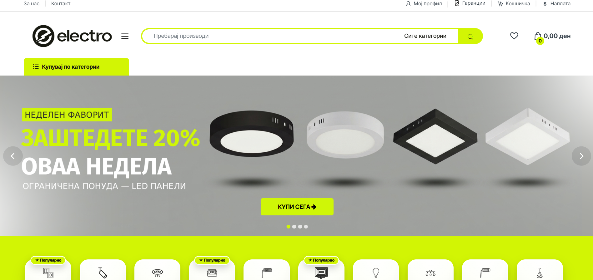
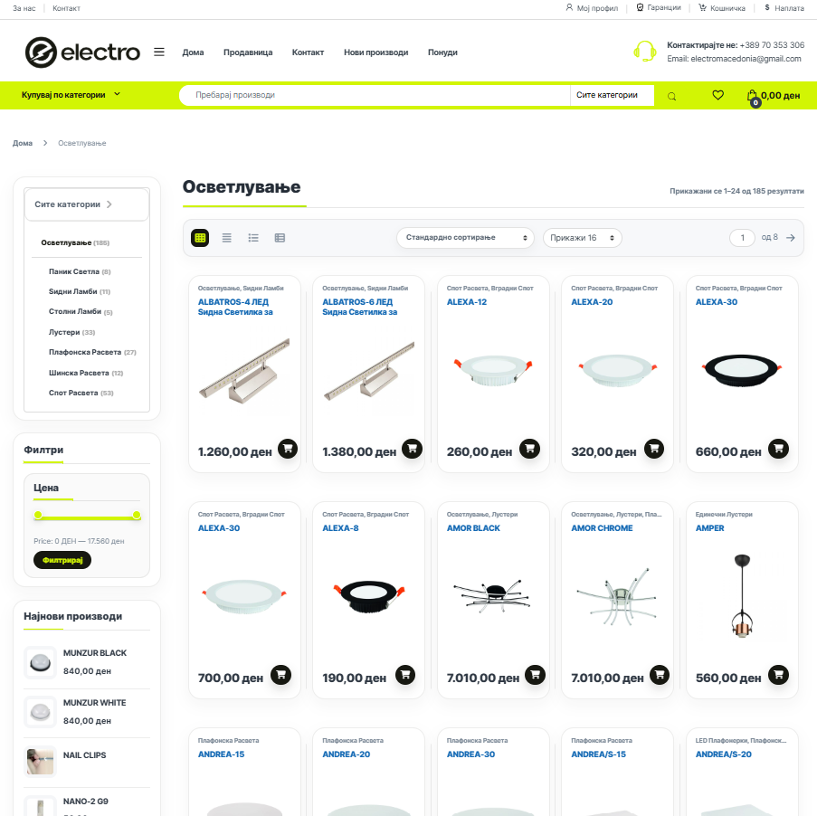
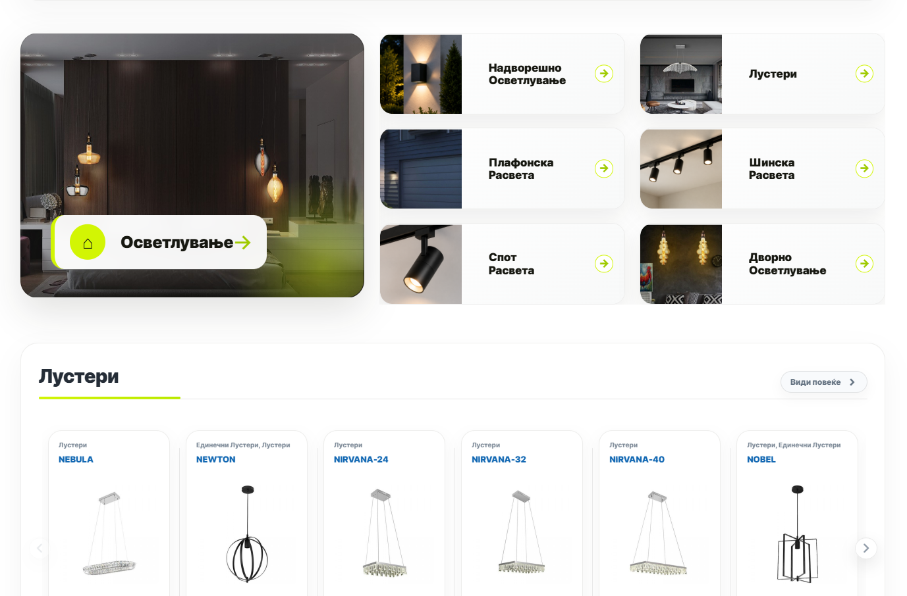
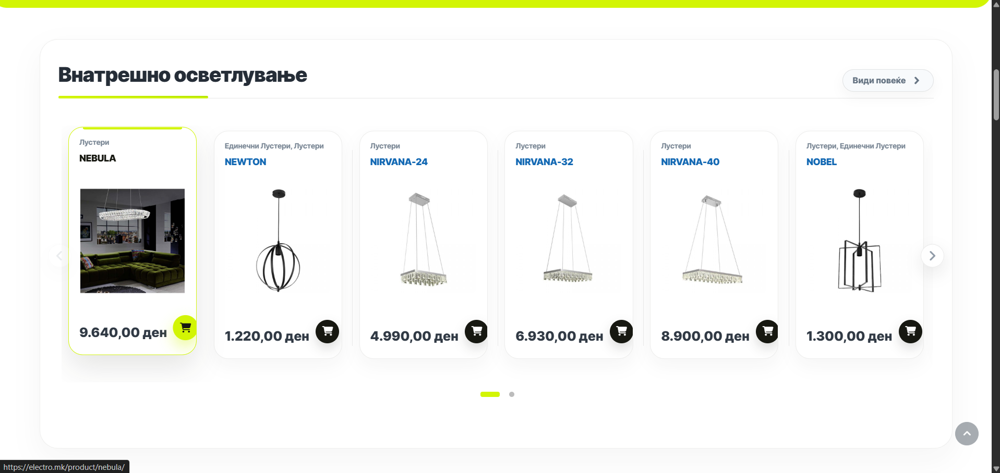

# Electro – WooCommerce store for a lighting shop in Skopje

🔗 **Live site:** [electro.mk](https://electro.mk)

Online store for Electro, a lighting and electronics shop in Skopje, North Macedonia. I built the site on my own for a real client, on WordPress and WooCommerce, in Macedonian. It is live and the shop uses it for its catalogue.

## What I did

- Came up with the design: the layout, colors and look of the homepage, category pages and product listings
- Built the sliders with Slider Revolution
- Organized the pages and the site structure for a large catalogue (the lighting category alone has 185 products)
- Translated the shop into Macedonian and came up with a snippets-based approach to handle the translations
- Wrote extra CSS on top of the theme to fine-tune the design (written with AI assistance, tested by me)

## Stack

WordPress · WooCommerce · Electro theme (MadrasThemes) · Slider Revolution · Advanced Custom Fields · Rank Math SEO · MailPoet · Loco Translate · Say What? · Asset CleanUp · Google for WooCommerce

## Screenshots

| Category page with filters | Home page categories |
|----------------------------|----------------------|
|  |  |

## Note

The site belongs to its owner, and the code and content are not published here. This repository documents my work on the project.